<p align="center">
  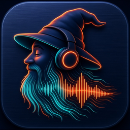
</p>

# WavWiz

[](LICENSE)
[](CHANGELOG.md)
[](https://wavwiz.com)

**Multi-zone audio wizardry.**

WavWiz turns an always-on Windows PC into a multi-zone music server for homes, shops, restaurants and offices. Play different music in every zone, or the same music in sync everywhere, on your PCs, phones, and tablets. No music library? No problem: AirPlay from any app on your iPhone, iPad or Mac to one zone or to "WavWiz – Everywhere." Phones play from the browser, with no app to install. No cloud account, no analytics, no telemetry, and WavWiz doesn't open ports to the internet. (Internet radio, tag and cover lookups, online album covers and artist photos (which you can switch off), and the optional Spotify Connect reach the internet.)

> **Public beta.** Expect rough edges and frequent updates. Please report bugs via [GitHub Issues](https://github.com/vdubbin74/WavWiz/issues).

**Latest:** v0.4.9 Beta (Oct 24, 2026) · **Download:** [WavWiz-Setup-0.4.9.exe from the latest release](https://github.com/vdubbin74/WavWiz/releases/latest) · **Website:** [wavwiz.com](https://wavwiz.com) · **Repo:** [github.com/vdubbin74/WavWiz](https://github.com/vdubbin74/WavWiz)

---

## Screenshots

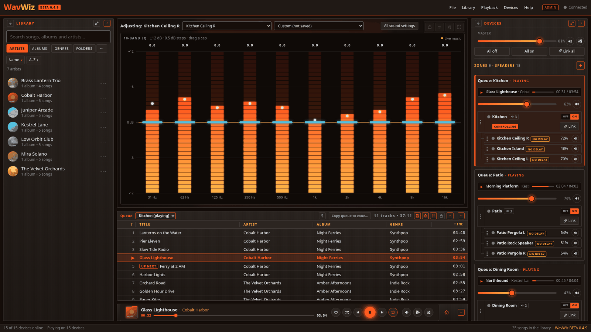

| Zones and speakers | Master volume | Jukebox zone |
| --- | --- | --- |
| 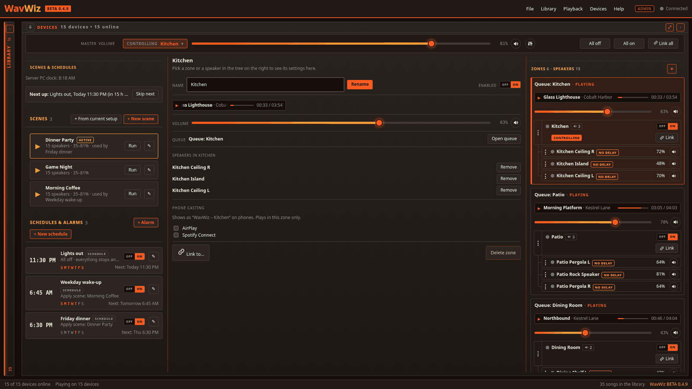 | 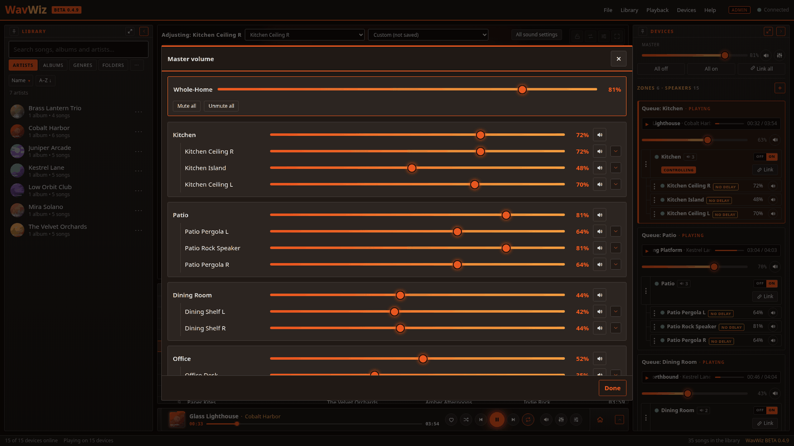 | 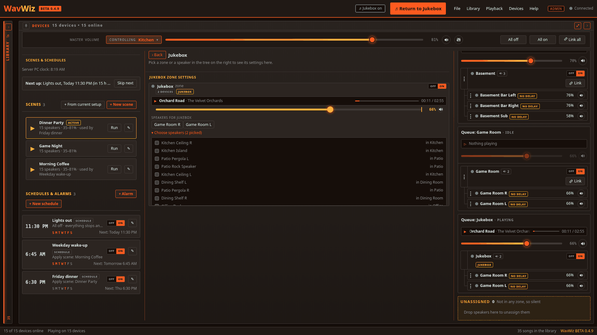 |

| Speaker settings | Sound (EQ) with Lock EQ | Settings > Appearance > Theme |
| --- | --- | --- |
| 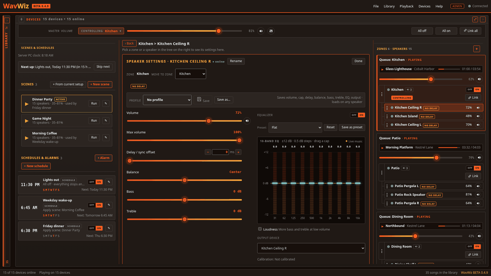 | 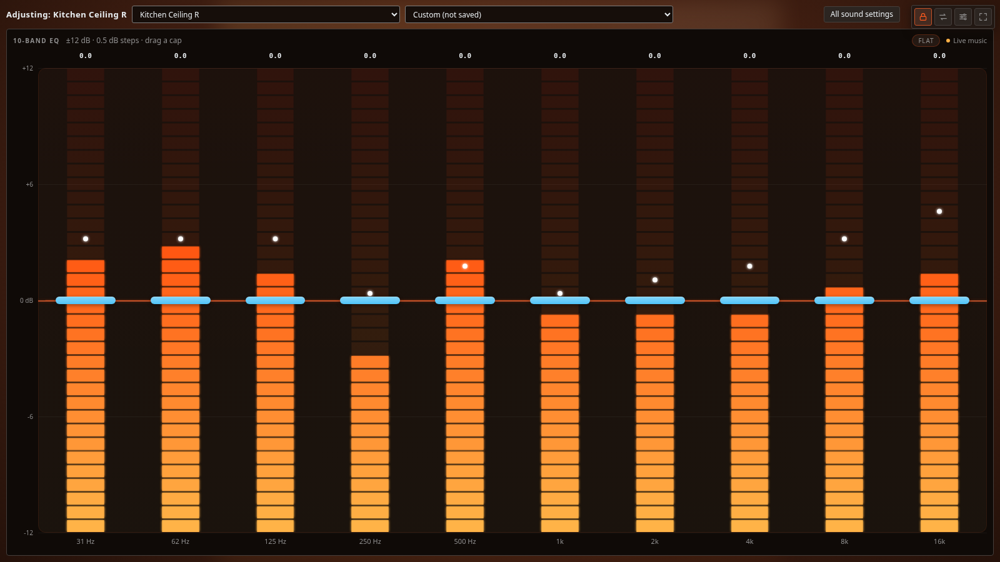 | 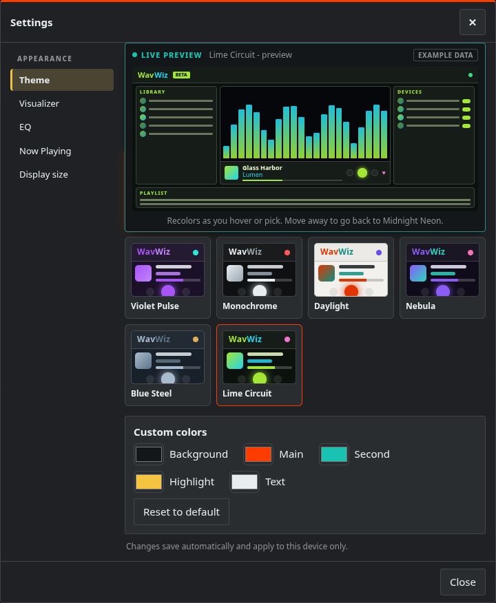 |

**Hover menus: the Sleep timer times appear when you hover over it**

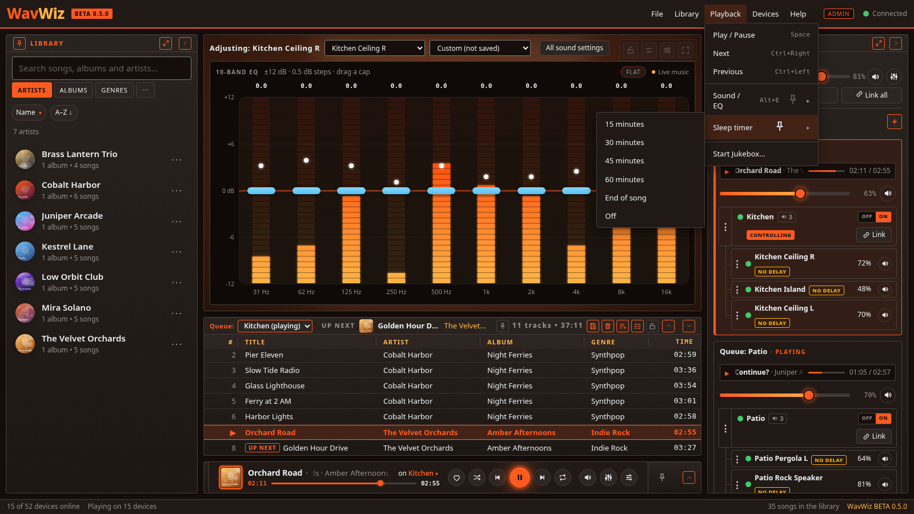

**Compact Now Playing bar: everything on one line**


| Phone (browser) | Music folders |
| --- | --- |
| 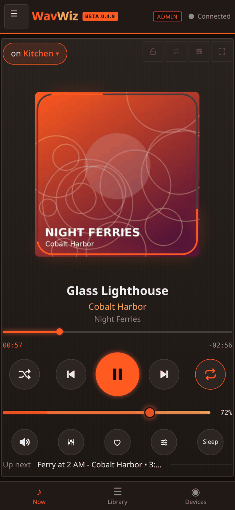 | 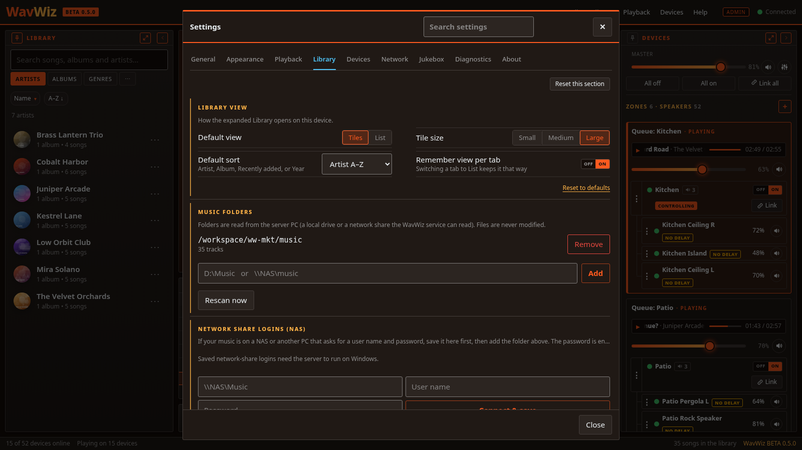 |

**Visualizers**

| Graphic EQ | Ring | Speaker cone | VU meters |
| --- | --- | --- | --- |
| 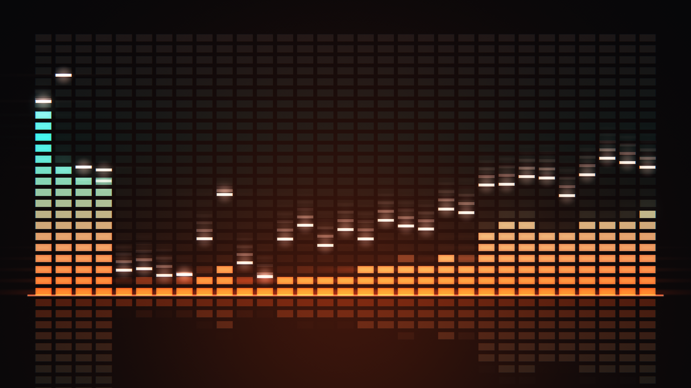 |  |  | 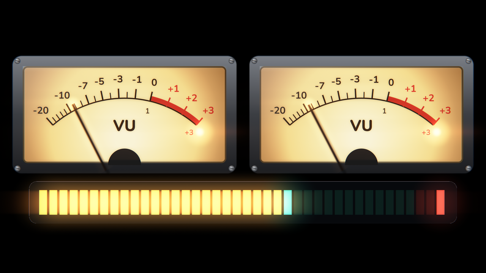 |

**Themes**

| Ember | Arctic | Pepecoin | Violet Pulse |
| --- | --- | --- | --- |
| 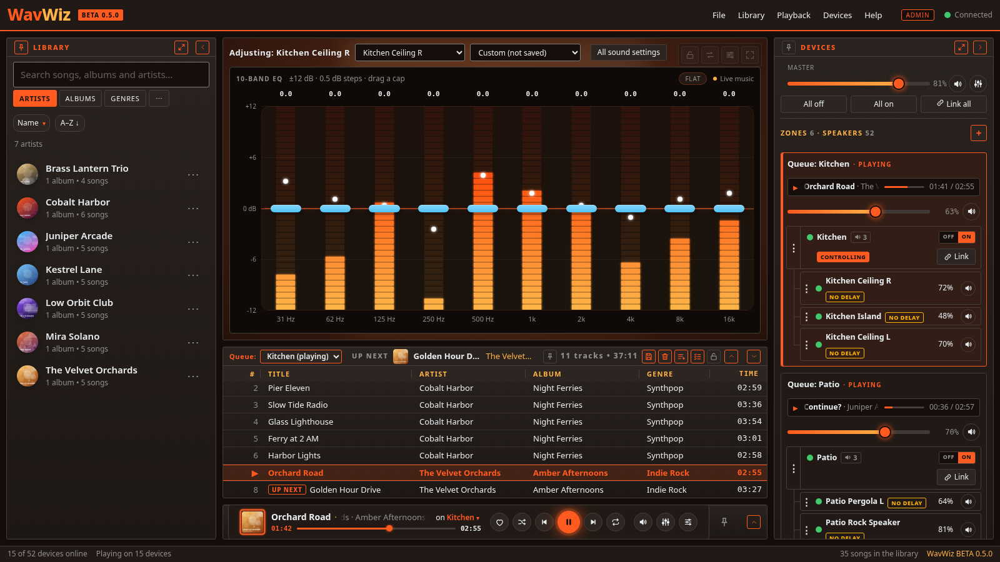 | 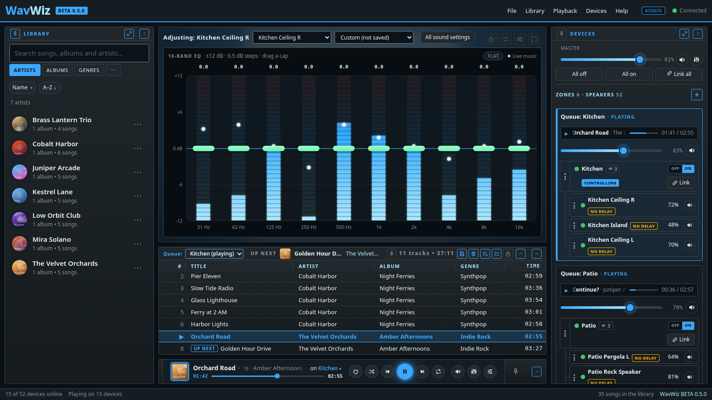 | 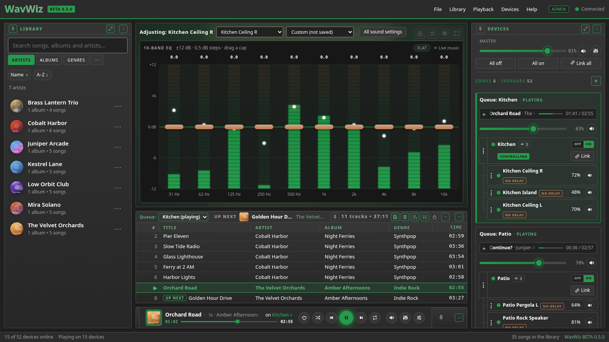 | 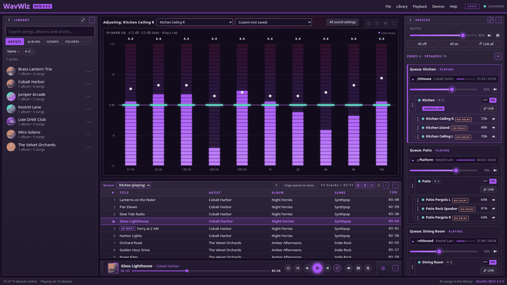 |

**Installer**

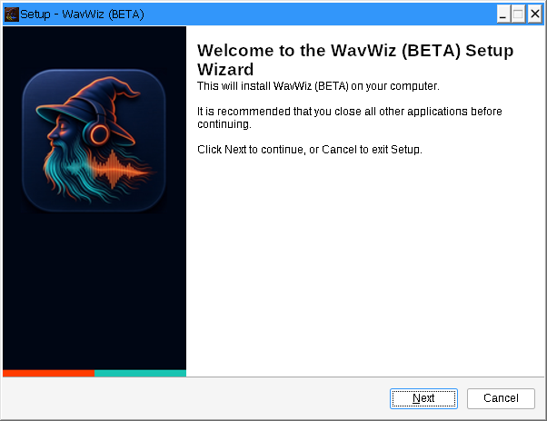

---

## Features

- **Different music in every zone** — Each zone has its own queue and plays its own music, or link zones to play the same thing. Scenes save your zone layout, and schedules, alarms and the sleep timer can target a single zone, the Jukebox or every zone.
- **Multi-zone sync** — The speakers in a zone play the same stream against a shared clock, and WavWiz keeps correcting each device's drift: Windows PCs with WavWiz Player, plus phones, tablets, and Macs in the browser. Every browser that opens WavWiz joins as a speaker by itself. No sync measurements are published yet.
- **Devices, zones and scenes** — Master volume and Mute all, plus volume, Mute and on/off for every speaker. In the Expanded Devices view, each device card opens its settings in place, in a wide center column: volume, volume cap, delay, balance, bass, treble, EQ, audio output, connection, Rename, Set as reference, and Forget. Save these settings as a **profile** and load them on any device; a scene can pick a profile for each device. Balance is applied by WavWiz Player. The normal Devices list stays compact; tap a device's name to jump to its card. Expanded, the Devices panel shows three bordered columns (click anywhere on a card to open it; drag cards to reorder) with a **Now playing** strip and an All off / All on / master volume row: **Scenes & Schedules** (create and edit scenes, schedules and alarms right there), **Zones** (optional groups such as “Downstairs”, each with one volume bar, Mute and an OFF | ON switch for all its speakers), and **Speakers** on the right (grouped by zone, with an Unassigned group and **+ Add to zone**). Revoking a device removes it everywhere at once; it has to pair again.
- **Per-device delay (0–1000 ms)** — Live slider and number box so Bluetooth speakers and Wi-Fi PCs line up instead of echoing between devices; on PCs the delay is kept per audio output. **Calibrate speakers** first checks the microphone level at each spot and tells you how to fix a weak reading, then measures it with the microphone of a WavWiz Player PC (USB, headset or built-in mic; recommended), or by ear. Only the zones being measured pause, and your volume is restored afterward.
- **AirPlay, built in: no music library needed** — AirPlay from any music app on your iPhone, iPad or Mac. Each zone can appear as its own AirPlay speaker (**WavWiz – <zone>**, switched on per zone), and **WavWiz – Everywhere** plays in every zone in sync, with title and artwork on Now Playing. Two zones can play different casts side by side.
- **Optional Spotify Connect** — Off by default. Turn it on in Settings → Network; WavWiz appears in Spotify’s device list, for every zone or one zone at a time. **Requires your own Spotify Premium account.** Unofficial open-source client (librespot); not made or endorsed by Spotify.
- **Library** — Big cover tiles, album pages, artists, genres, and folders, with sorting and a letter strip on every tab, favorites (hearts), playlists, queue, internet radio, and optional CD ripping. Missing covers and artist photos are looked up online (MusicBrainz, Cover Art Archive, Wikidata / Wikimedia Commons, TheAudioDB; can be switched off), and anything still missing gets a generated cover in your theme colors. Missing tags/covers can be suggested from MusicBrainz (nothing is written until you approve it). Password-protected NAS shares, gapless album playback, and automatic volume leveling (ReplayGain / R128).
- **Now Playing** — Four control panel styles (Classic, Center, Stack, Horizon) with adjustable panel effects. Minimized, the whole panel fits on one line in your style and theme, and the minimized Playlist shows what's up next.
- **Master Volume mixer** — Every zone and speaker in one window, with each speaker's Delay and Max volume right there.
- **Studio Max streaming** — Settings → Playback → Streaming quality picks Studio (24-bit / 48 kHz) or Studio Max (24-bit / 96 kHz). Players that can't play 96 kHz get 48 kHz in sync with the rest.
- **10-band EQ per speaker** — Shown live in the middle of Now Playing by default (one toggle switches to the visualizer). Three looks (LED bars, Studio faders, Spectrum curve) with LED level bars that follow the real level of each band, pre-gain, loudness and limiter. One **All sound settings** button expands presets (by situation, speaker type and music style), Bass, Treble, Trim, Balance and more in place. **Lock EQ** keeps the mouse wheel and stray clicks from changing it.
- **Visualizers** — Eight original looks (Particle burst, Waveform river, Speaker cone, Ring, Neon tunnel, Spectrum, VU meters, Graphic EQ), each with its own 0–100% effect controls (50% default), a Quality setting (Auto / Low / High / Ultra), and GPU post effects.
- **Themes** — Ten presets plus Custom colors (Background, Main, Second, Highlight, Text). Settings → Appearance has live, pinned previews for Theme, Visualizer, EQ, and Now Playing.
- **Jukebox zone (beta)** — The Jukebox is its own zone with its own speakers. A locked party screen: guests scan a QR code and add songs from their phone (no app, no sign-in), within the rules you set (allowed music, songs per guest, vote to skip, auto-fill). Modern and Retro CD styles, with preview cards in Settings → Jukebox. Only the host PIN exits; for a fully locked public PC use Windows Assigned Access.
- **Control without playing** — Any phone, browser or PC can control the music without playing it: just leave its speaker switched off.
- **Mini player** — WavWiz Player opens a small window with cover, title, seek bar, previous / play / next, mute and a large volume bar. Alt+M shows or hides it; up to five pinned shortcuts and Home sit next to the controls. Pin it on top, make it slim, or make it see-through (solid again on hover).
- **Queue** — Reorder songs in every view (Ctrl/Shift multi-select, Ctrl+Z to undo), lock the queue and its sort order, and right-click (long-press on a phone) a song for Play next, Move to top, Remove and more. Drop songs, albums or folders from the Library right where you want them.
- **Max-volume lock** — An admin can cap any device's volume and lock it; nothing raises it above the cap (master, zones, scenes, alarms, the API). A capped bar shows a marker at the limit.
- **Add to home screen** — On a phone or tablet, add WavWiz to the home screen to open it like an app, full screen with its own icon. On a phone, Now Playing works as a full-screen remote.
- **Alarms (beta), sleep timer, crossfade** — Alarms with fade-in, snooze and skip in the Scenes & Schedules column of Expanded Devices, a Sleep button in Now Playing with fade-out, and optional crossfade (off by default; never inside an album).
- **Backup and restore** — File menu: Import settings, Restore backup, Export settings and Back up now. One file with settings, playlists, scenes, alarms, EQ presets and device names; no passwords or certificates in it. Restore shows a summary first and offers Undo restore.
- **Shortcuts and pins** — Space, Ctrl+Right / Left, M, Alt+M, Alt+H, Alt+E, Alt+Q and Ctrl+, (listed in Help → Keyboard shortcuts); media keys work with WavWiz Player on Windows. Pin up to five shortcuts next to Home with one click.
- **Menus that save clicks** — Choice lists open as hover submenus (Sleep timer, Sound / EQ, Playlists, and lists of your devices, zones and scenes). File → New creates a zone, scene, alarm or schedule (Ctrl+Shift+Z / S / A / H; some browsers reserve a few of these), and File → Run starts a scene, schedule or alarm.
- **Playlist columns** — Show or hide columns from the checklist icon (or right-click the header), drag to resize or reorder, click a header to sort, and lock the layout.
- **Admin mode** — File → Sign in as admin… unlocks server settings on any paired device without signing out; admin-only items are read-only (never hidden) for everyone else.
- **Privacy-first** — Local network only by default. Optional private remote access via Tailscale (you bring your own Tailscale setup); WavWiz does not open ports to the public internet for you.

AirPlay is a trademark of Apple Inc. Spotify is a trademark of Spotify AB. WavWiz is not affiliated with either.

---

## Requirements

| Role | Needs |
| --- | --- |
| **Server** | 64-bit Windows 10 (October 2018 Update or newer) or Windows 11, on a PC that stays on; admin rights to install (self-contained installer; nothing else to install for the core app) |
| **Players** | Windows PCs with speakers (WavWiz Player), or any modern browser on a PC, Mac, phone, or tablet on the same network. Smart-TV browsers are still in testing (they get a lighter layout and visualizer), and older LG webOS sets don't finish loading yet, so for now use a PC or laptop connected to the TV. Feedback on your TV is welcome |
| **Player window** | Microsoft Edge WebView2 Runtime (included with Windows 11 and current Windows 10); without it the player opens in your default browser |
| **Spotify Connect** (optional) | Listener’s own **Spotify Premium** account; feature off by default |
| **AirPlay** | iPhone, iPad, or Mac on the same local network (Private network profile recommended) |

The installer is **not Authenticode-signed yet**, so Windows SmartScreen may warn. Prefer downloads from the official [Releases](https://github.com/vdubbin74/WavWiz/releases) page only.

---

## Quick install

1. Open [Releases](https://github.com/vdubbin74/WavWiz/releases/latest) and download the latest `WavWiz-Setup-*.exe`.
2. Verify the published SHA-256 if one is listed on the release.
3. Run the installer:
   - On the music PC: install **WavWiz Server**, keep the **Private / home-network** address (do not bind to all interfaces), finish, open the web UI, set an administrator password, and add music folders in **File → Settings… → Library**.
   - On each PC with speakers: install **WavWiz Player**; it discovers the server—pair with the 6-digit code from **Settings → Devices** if asked.
   - On phones and tablets: open the server's web page in the browser on the same Wi-Fi.
4. Read [docs/FIRST-RUN.md](docs/FIRST-RUN.md) for Private network, devices and calibration, the menus and Settings, AirPlay, and optional Spotify Connect tips.

Upgrading? Run the new installer over the old one, even while WavWiz is running; it closes WavWiz first and keeps your library, settings, and pairings.

More detail: [wavwiz.com](https://wavwiz.com).

---

## Build from source

High-level overview (Windows or a cross-build environment with the tools described in the repo):

```text
dotnet build WavWiz.sln -c Release -warnaserror
dotnet test tests/WavWiz.Core.Tests -c Release
# also: Dsp, Measure, Sim, Server.Tests; tests/js/run.sh; installer script tests
build/build-ffmpeg-lgpl.sh          # LGPL-only FFmpeg (when rebuilding media stack)
pwsh build/build.ps1 -Installer     # win-x64 publish + Inno Setup installer
```

Project layout and deeper notes: see `docs/` in this repository (architecture, installer). For first-time users of a binary install, start with [docs/FIRST-RUN.md](docs/FIRST-RUN.md). Third-party and LGPL obligations: [docs/THIRD-PARTY.md](docs/THIRD-PARTY.md) and [THIRD-PARTY-NOTICES.txt](THIRD-PARTY-NOTICES.txt).

---

## Contributing & support

- Contributing: [CONTRIBUTING.md](CONTRIBUTING.md)
- Code of conduct: [CODE_OF_CONDUCT.md](CODE_OF_CONDUCT.md)
- Help / bugs: [SUPPORT.md](SUPPORT.md)
- Security: [SECURITY.md](SECURITY.md) — please **do not** file public issues for vulnerabilities
- Changelog: [CHANGELOG.md](CHANGELOG.md)
- Community: Discord server and r/WavWiz, coming soon.

---

## License

[MIT](LICENSE) — Copyright (c) 2026 vdubbin74

Third-party components keep their own licenses; see [THIRD-PARTY-NOTICES.txt](THIRD-PARTY-NOTICES.txt) and [NOTICE](NOTICE).

---

*(WavWiz was called “Unison” in very early betas; the installer upgrades in place and keeps library, settings, and pairings.)*
